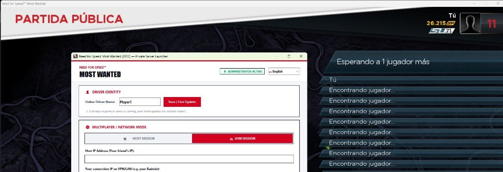

# Need for Speed: Most Wanted (2012) — Native Windows LAN / VPN Private Server & Launcher

A native **Blaze / Autolog** private server and all-in-one GUI launcher to play **Need for Speed: Most Wanted (2012)** (PC Retail) over **LAN** or **VPN** (Radmin VPN, ZeroTier, Hamachi, etc.) directly on Windows — no Docker, no WSL, and no virtual machines required.



---

## Credits & License

This project **is based on the original `nfs13` project by `sn0wd0wn` (`gregel`, `Dantiox`, `Alexes`)**, the original authors of:
- The reverse-engineered Blaze RPC, Autolog HTTP, QoS, and Matchmaking protocols for NFS Most Wanted (2012).
- The core server backend (`server/server.py`), unit test suite (`server/test_server.py`), and binary client patcher (`client/patch_nfs13.py` / `client/patches/nfs13_online.json`).

### What this native Windows port adds
- **Pure-Python SSLv3 frontend (`server/ssl_proxy.py`):** replaces the Linux/Docker `stunnel-ssl3` container with `tlslite-ng` to terminate SSLv3 natively on Windows ports `42127` and `44125`.
- **All-in-one GUI Launcher (`launcher.py` / `NFSMW_Launcher.exe`):**
  - **Host** and **Join** workflows in a single window without manual file editing.
  - Automatic network interface detection (prioritizing Radmin VPN, ZeroTier, Hamachi, and local LAN adapters).
  - Automatic Windows `hosts` redirection on launch and clean restoration on exit.
  - Built-in client patcher to generate `NFS13.online.exe` from an untouched `NFS13.exe` without altering the original executable.
  - Live player rename (`/rename`), Speedlist pool selector (`all_races`, `sprints`, `circuits`, `dlc_airport`, `mixed`, `challenges`), and 6 UI languages (`en`, `es`, `ru`, `pt`, `fr`, `de` — **English by default**).
- **Multiplayer stability fixes:**
  - Implemented `UserSessions::lookupUser` (`0x000C`), `lookupUsers` (`0x000D` / `0x001A`), `lookupUsersByPrefix` (`0x000E`), `fetchExtendedData` (`0x0003`), `SUBS=1` presence flags, `NotifyUserAdded` (`DATA` + `USER`), and dynamic `ULST` game membership so the first player no longer crashes when a second player logs in or joins a session.
  - Two clean NULL-pointer anti-crash guards (`0x004C364E` and `0x00A82B55`) included in the client patch.
- **Helper utilities (`tools/`):** Windows Firewall port rule script, manual hosts/patch helpers, portable `.exe` build script (`build_launcher.bat`), and a solo 2nd-player protocol simulator (`simular_jugador2.bat`).

### License
The Blaze/Autolog backend (`server/`), SSLv3 frontend (`server/ssl_proxy.py`), server runner (`run_server.py`), and binary patcher (`client/patch_nfs13.py`) remain licensed under **`AGPL-3.0-only`** (`Copyright (C) 2026 sn0wd0wn (gregel, Dantiox, Alexes)`). The GUI launcher (`launcher.py`) is licensed under **`MIT`**. See the header of each file for exact license notices.

---

## Requirements

### Ready-to-run package (no dependencies required)
If you download a release ZIP or run `NFSMW_Launcher.exe`:
- **Windows 10 / Windows 11 (64-bit)** with Administrator privileges (required to temporarily update `C:\Windows\System32\drivers\etc\hosts`).
- **Need for Speed: Most Wanted (2012)** PC Retail copy with an untouched **`NFS13.exe`** (`13,672,448` bytes, SHA-256 `9571280bb8868cd254e95442181d7bf1d6eafb2156a95d0c38337c7470762c0f`).
- All players connected to the **same LAN** or **same VPN network** (e.g., Radmin VPN or ZeroTier).
- **No Python or third-party packages need to be installed**: `NFSMW_Launcher.exe` bundles Python, Tkinter, `tlslite-ng`, certificates, the patcher, and the full server into a single portable executable.

---

## Quick Start

### 1. Patch the game (first time only, every player)
1. Open **`NFSMW_Launcher.exe`** (accept the Windows UAC Administrator prompt).
2. Under **Game Executable**, click **`Patch NFS13.exe`** and select your original **`NFS13.exe`**.
   *(Alternatively, drag and drop `NFS13.exe` onto `tools\parchear_juego.bat`.)*
3. **`NFS13.online.exe`** will be created next to `NFS13.exe` without modifying the original binary. Make sure **`NFS13.online.exe`** is selected in the Launcher.

### 2. Host (creates the private server & session)
1. *(First time only)* Run **`tools\configurar_firewall.bat`** as Administrator to allow the server and P2P ports in Windows Firewall.
2. Open **`NFSMW_Launcher.exe`**.
3. Select **`HOST SESSION`**.
4. Pick your **Radmin VPN / ZeroTier / LAN** IP from the dropdown and click **`Copy IP`** to share it with your friends.
5. Set your **Online Name** (1–15 chars: letters, digits, `_`, or `-`), choose a Speedlist mode, and click **`HOST AND PLAY`**.
   - A server console window opens automatically, followed by the game connected to your server.

### 3. Join (connects to the host's server)
1. Open **`NFSMW_Launcher.exe`**.
2. Select **`JOIN SESSION`**.
3. Paste the **Host IP** provided by your friend.
4. Enter your **Online Name**, verify `NFS13.online.exe` is selected, and click **`PLAY`**.

### 4. In-Game
1. Open **EasyDrive** and go to **Multiplayer** / **Friends Game** / **Public Game**.
2. Players appear on the map and can start Speedlists, races, and takedowns together.
3. Closing the game (or clicking **`Clean Hosts`** in the Launcher) automatically removes the temporary `ea.com` entries from your Windows `hosts` file.

---

## How It Works

`NFS13.online.exe` bypasses the EA/Origin retail login check and connects to the EA domains redirected via `hosts` (`gosredirector.ea.com`, `nfs13-pc.blaze.ea.com`, `demangler.ea.com`, `peach.online.ea.com`, etc.):

| Service | Port(s) | Purpose |
| :--- | :--- | :--- |
| **Blaze RPC (SSLv3)** | `TCP 42127` → `127.0.0.1:42128` | SSLv3 frontend (`tlslite-ng`) forwarding to the Blaze backend (`UserSessions`, `GameManager`, `AssociationLists`, `Util`, matchmaking, and friend presence). |
| **HTTPS Redirector (SSLv3)** | `TCP 44125` → `127.0.0.1:44126` | Initial client redirect to the private Blaze server address. |
| **Autolog HTTP API** | `TCP 8080` | Dynamic Speedlist/playlist endpoints, friend profiles, and live player rename (`GET /rename?name=YourName`). |
| **QoS Latency** | `TCP/UDP 17500` | QoS probe handler returning the configured server IP. |
| **P2P Game Mesh** | `UDP 3659` | Direct peer-to-peer gameplay and race traffic between connected players. |

IP-to-persona profiles are stored automatically in `server/players.json` on first login (generated at runtime and excluded via `.gitignore`).

---

## Building from Source (Portable, Zero-Dependency `.exe`)

To build **`NFSMW_Launcher.exe`** yourself so it runs on any Windows PC without installing Python or dependencies:

1. Install **Python 3.10+** on Windows (with `tkinter` enabled in the installer).
2. Install dependencies:
   ```bat
   pip install -r requirements.txt
   ```
3. Run the build script:
   ```bat
   tools\build_launcher.bat
   ```
   Or invoke PyInstaller directly from the repository root:
   ```bat
   python -m PyInstaller launcher.spec --noconfirm
   ```
4. The compiled single-file binary is copied to `NFSMW_Launcher.exe`.
   `launcher.spec` bundles the Python runtime, Tkinter, `tlslite-ng`, `certs/`, `client/patch_nfs13.py`, `client/patches/nfs13_online.json`, `run_server.py`, `server/`, and `icon.ico`.

> **Clean distribution tip:** Before compiling `NFSMW_Launcher.exe` for redistribution, ensure `server/players.json` and `server/speedlist_mode.json` do not exist locally, as `launcher.spec` packages the `server/` directory into the executable.

---

## Tests & Development Tools

- **Run the server unit test suite:**
  ```bat
  python -B -m unittest discover -s server -p "test_*.py"
  ```
- **Solo 2nd-player protocol test:**
  While in Multiplayer after clicking `HOST AND PLAY`, run `tools\simular_jugador2.bat`. It connects a full Blaze/SSLv3 client from `127.0.0.2`, tests friend presence + `lookupUser` + lobby join (`joinGame`), and cleans up its temporary `players.json` entry on exit *(Blaze/lobby flow only; does not send UDP 3D race traffic)*.

---

## Repository Layout

```text
NFSMW2012_LAN_Windows/
├── NFSMW_Launcher.exe          # All-in-one portable executable (no dependencies required)
├── launcher.py                 # Tkinter GUI launcher, hosts manager & built-in patcher
├── launcher.spec               # PyInstaller --onefile spec (bundles server + tlslite-ng)
├── run_server.py               # Combined SSLv3 proxy + Blaze/Autolog server entrypoint
├── iniciar_servidor.bat        # Dedicated/console server quick launch
├── requirements.txt            # Python dependencies for source runs & builds
├── INSTRUCCIONES_LAN.txt       # Plain-text LAN/Radmin quick guide (Spanish)
├── assets/
│   └── preview.jpg             # README preview screenshot
├── certs/                      # Self-signed *.ea.com certs for local SSLv3 termination
├── client/
│   ├── hosts.txt               # List of redirected EA domains
│   ├── patch_nfs13.py          # Standalone CLI executable patcher
│   └── patches/
│       └── nfs13_online.json   # Retail executable patch + NULL-pointer anti-crash guards
├── server/
│   ├── server.py               # Blaze RPC, Autolog HTTP, and QoS backend
│   ├── ssl_proxy.py            # Pure-Python SSLv3 terminating frontend (tlslite-ng)
│   └── test_server.py          # Unit test suite (51 tests)
└── tools/
    ├── build_launcher.bat      # Builds NFSMW_Launcher.exe via PyInstaller
    ├── configurar_firewall.bat # Opens required TCP/UDP ports in Windows Firewall
    ├── configurar_hosts.bat    # Manual Windows hosts configuration helper
    ├── limpiar_hosts.bat       # Removes EA redirects from Windows hosts
    ├── parchear_juego.bat      # Drag-and-drop NFS13.exe patch helper
    ├── simular_jugador2.bat    # Launches the 127.0.0.2 2nd-player simulator
    └── simular_jugador2.py     # Blaze/SSLv3 test client
```
